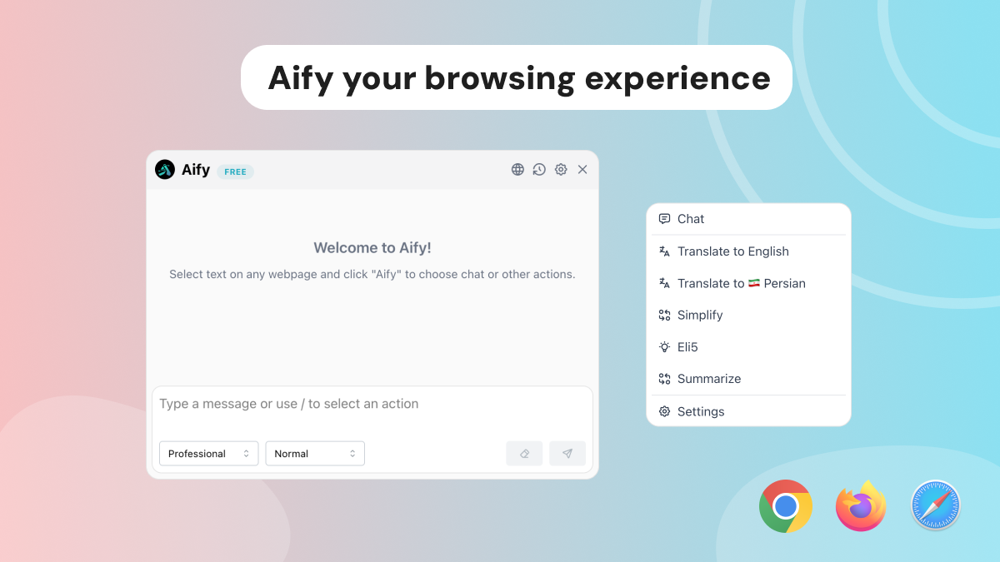

# Aify Browser Extension



A minimal and powerful AI assistant that enhances your browsing experience with text transformations and translations.

## Features

- 💬 **Streaming chat** in Chrome’s side panel or directly on the page, with local history and separate versions for edits and regenerated replies.
- 🎭 **Custom agents** with their own instructions, avatars, model settings, and opt-in access to the current page.
- 📎 **Page attachments** that capture text and optional images, including from virtualized lists as you scroll. Preview and remove chunks before sending.
- ⚡ **Saved Quick Actions** that run a preset instruction with your chosen agent. Hover over a matching area to see what the action will capture.
- 🛡️ **Block List** with per-site rules, previews, element and keyword markers, and daily counts for the last 30 days plus an all-time total.
- 🌍 **Selected-text tools** for translation and rewriting, with a one-click default action and a menu that adjusts as you scroll.
- 🔌 **Custom OpenAI-compatible endpoints** and **Light, Dark, or Auto** themes.

## Installation

Download and extract the latest build from [GitHub Releases](https://github.com/amirrezasalimi/aify/releases). In Chrome, open `chrome://extensions`, enable **Developer mode**, then choose **Load unpacked** and select the extracted folder.

## Using Aify

### Chrome side panel

Click Aify in Chrome’s toolbar to open the sidebar. If the icon is missing, pin it from the Extensions menu. To chat about selected text, use **Aify → Chat** on the page. Firefox uses the in-page chat.

### Chat agents

Create agents under **Settings → Agents** and switch between them below the chat box. Set each agent’s **Soul** (instructions), avatar, and optional model override when **Use Custom API** is enabled. **Auto** uses the model selected in General.

**Read current page** is an opt-in tool. When a tool-capable model calls it, Aify shares an excerpt, up to three images, and up to 40 visible links with your AI provider. It doesn’t open linked pages. Image analysis requires a vision-capable model.

### Attach a page element

Click the paperclip in chat and hover over the page. Press **↑** for a larger area or hold **Alt/Option** for the exact element. Click to lock the selection, then **+** to attach it or **Esc** to cancel. For a virtualized list, select its container and scroll to collect distinct rows as they appear.

Open the numbered paperclip to preview or remove attachments and individual chunks. **Include images** is on by default; turn it off to send only text. Aify captures up to eight prominent images per selection, using loaded pixels where possible and URLs otherwise. URL previews may load when opened; URL-based image inputs require a provider that can fetch them.

Attachments are shared with your AI provider only when you send the message and are kept in local chat history.

### Block unwanted page areas

1. In **Settings → Block List**, choose **Select parent area**, pick the area, and click **Save parent**. Use **↑** to select a larger container.
2. Narrow the rule with **Add element markers** (such as a “Sponsored” badge) or **Add keyword markers** (one word or phrase per line). All markers must match. You can reselect the parent and edit its markers separately.
3. In **Preview**, dashed amber outlines show partial matches and purple shows full matches. Hover over saved paths or keywords to inspect them. Switch to **Hide** when ready, or **Off** to restore hidden areas.

Rules apply locally to the saved hostname, including newly loaded content. Each rule shows today’s count, a 30-day daily breakdown, and an all-time total. Only **Hide** mode counts, once per element per rule per page load.

### Chat history

Chats are saved locally. Use **History → Chats → Resume** to continue a conversation or **Text actions** to find past transformations. Editing and resending a message creates a new chat entry without changing the original.

## Development

Built with WXT, React, Mantine, and Tailwind CSS.

```bash
bun install
bun run dev
bun run compile
bun run build       # Chrome
```

WXT doesn’t open Chrome automatically. Load `.output/chrome-mv3` using **Load unpacked** and reload the extension after restarting the dev server.

For Firefox releases only, run `bun run build:firefox`. To load it temporarily, choose **This Firefox → Load Temporary Add-on** in `about:debugging` and select `.output/firefox-mv2/manifest.json`.

## Usage Considerations

This extension is open-source and free for personal use only. Commercial use is not permitted without explicit permission.

## Contributing

Contributions are welcome! If you'd like to contribute to Aify, feel free to open issues or submit pull requests.
